# Módulo EVCS — eletropostos e hubs de recarga

Responsável: **Ayrton** · branch `feature/evcs-ayrton` · configuração `configs/evcs.yaml` · notebook `notebooks/01_evcs_ayrton.ipynb`

Este módulo modela a recarga pública de veículos elétricos no alimentador **IEEE 8500** (redução de média tensão: ~11 × 12 km, 170 km de linhas, 2.521 barras, 10,8 MW na ponta). Ele faz três coisas:

1. Simula **sessões de recarga** minuto a minuto de uma **frota mista** (carros particulares e táxis/aplicativo): cada veículo tem uma bateria, chega com um SOC, espera na fila se preciso e carrega até uma meta.
2. **Dimensiona e aloca** três tipos de estação: hubs DC, eletropostos AC trifásicos e eletropostos AC monofásicos. Os hubs são alocados por cobertura máxima; os eletropostos, por uma otimização (MILP) que cobre toda a carga com o menor custo.
3. Calcula as **curvas diárias e intradiárias (15 min)** de demanda e o impacto na rede, comparando com o **caso base S0** (sem estações).

> ⚠️ **Dois ajustes em relação aos dados IEEE 8500** (detalhes em [`data/ieee8500/README.md`](../../data/ieee8500/README.md), seção *Ajustes do estudo*):
> 1. **Ampacidade das linhas** pela bitola do condutor (397 ACSR 587 A … #4 ACSR 140 A), no lugar de 400 A fixos.
> 2. **Nível de tensão:** fonte em 1,00 pu e todos os reguladores com alvo de 1,03 pu, no lugar de 1,05 / 1,054 / 1,042 pu.
>
> Com eles o caso base S0 fica dentro de 0,95–1,05 pu e sem sobrecargas relevantes.

> Todos os valores de `planning:` no `evcs.yaml` são **hipóteses** até termos dados de Honduras. A formulação completa (frota, sessões, MILP de alocação, indicadores, solvers) está em [docs/metodologia.md](../../docs/metodologia.md).

> A integração S0–S4 com BESS e V2G (Kenia e Cesar) também roda no IEEE 8500. A estação da integração (`station.bus`), a BESS e o V2G ficam na barra `m1125976`, local de um dos hubs DC que a triagem escolhe.

## Arquivos

| Arquivo | O que faz |
|---|---|
| `planning.py` | Frota mista, tipos de estação, sessões, fila, dimensionamento e escolha de locais: hubs por cobertura máxima, eletropostos pela otimização de cobertura total (MILP). Não depende da rede. |
| `strategies.py` | Estratégias de demanda para a integração S0–S4 (`fixed`, `template`). |
| `runner.py` | `python -m evcs` (execução independente) e `run_integrated` (contrato com o coordenador). |
| `model.py` | Perfil de demanda da estação anfitriã do V2G, limitado pela potência da estação. |

Estudos que usam o módulo, em `src/integration/`:

- `evcs_screening.py`: capacidade da rede por barra × frota × cobertura.
- `s1_study.py`: S1 intradiário com as estações escolhidas.
- `service_transformers.py`: carregamento dos 1.177 transformadores de serviço no S0 e no S1 (sem fluxo de potência).

## Como uma sessão de recarga é calculada

A frota é **mista**, com duas classes de veículo (`fleet.classes`):
- **particulares:** 85 % dos veículos, muitos sem garagem;
- **táxis e aplicativo:** 15 %, com 200 km/dia e toda a recarga em estação pública.

Para cada classe e cada serviço (AC ou DC), sorteiam-se sessões até somar a energia pública diária daquela classe naquele serviço:

```
energia pública/dia da classe = veículos × share da classe × km/dia × kWh/km × parcela pública
energia da classe no serviço  = energia pública da classe × services (particulares AC 60 % / DC 40 %; táxis AC 20 % / DC 80 %)
```

São 9,07 kWh por veículo por dia nas estações, em média: 1.000 a 3.000 veículos pedem de 9,1 a 27,2 MWh/dia. Na rede, o que importa é essa energia, não o número de veículos: com a mesma energia por classe e serviço, as sessões são idênticas. Uma frota só de carros particulares com 30 % de recarga pública precisaria de ~10.000 carros para pedir ~19 MWh/dia, de 2 a 4 por domicílio, o que não é plausível.

Cada sessão:

| Grandeza | Como sai |
|---|---|
| Bateria | Normal(`battery_kwh`, `battery_std_kwh`) da classe, mínimo 10 kWh |
| SOC de chegada | Normal(`arrival_soc_mean`, `arrival_soc_std`) da classe, entre 5 % e a meta − 5 % |
| Energia | bateria × (`target_soc` − SOC de chegada) |
| Potência de recarga | mín(potência do carregador, limite do carro): `max_ac_kw` no AC, `max_dc_kw` no DC |
| **Tempo de recarga** | **energia ÷ potência** (arredondado para cima, em minutos) |
| Potência na rede | potência de recarga ÷ `charger_efficiency` |
| Hora de chegada | sorteada com os 24 pesos de `arrival_shape` (da classe, se ela tiver; senão, do tipo de estação), minuto uniforme dentro da hora |

**Fila:** as sessões são distribuídas entre as estações do mesmo tipo. Se todos os carregadores estiverem ocupados, o carro espera. Se a espera passar de `max_wait_min`, ele desiste e a energia conta como **não atendida**. O dia é periódico: uma recarga que passa da meia-noite continua no início do dia e ocupa o carregador ali. Para isso, a fila de um dia de aquecimento é simulada antes do dia estudado.

**Dimensionamento:** os carregadores de cada tipo são o percentil `sizing_quantile` (95 %) do número de carros carregando ao mesmo tempo, sem limite de carregadores. O número de estações é esse total dividido por `chargers_per_site`, arredondado para cima.

**Escolha de locais (triagem):**

A carga existente em cada barra é usada como indicador de onde os carros estão.

1. **Hubs DC** (primeiro, porque exigem mais da rede): entre as barras trifásicas candidatas (no IEEE 8500, as 647 trifásicas reduzidas a pontos a pelo menos `candidate_spacing_m` = 250 m → 101 candidatas, com a capacidade da rede calculada para cada uma), escolhe-se a que cobre mais demanda ainda descoberta dentro de `coverage_radius_m`, se a rede aceitar a potência do hub e se estiver a pelo menos `min_spacing_m` dos outros hubs.
2. **Eletropostos AC — otimização de cobertura total** (`ac_siting: full_coverage`): escolhe-se o conjunto de **menor custo** que deixa **toda a carga do alimentador a no máximo 500 m de um eletroposto**, resolvido exatamente como problema inteiro (cobertura de conjuntos, `evcs.planning.optimal_coverage`, scipy/HiGHS):
   - candidatas: **todas** as barras de média tensão; em barra trifásica cabe um **eletroposto trifásico** (`ac`, 6 × 22 kW, USD 60 mil); em ramal mono/bifásico, um **eletroposto monofásico** (`ac1`, 2 × 7,4 kW numa fase, USD 24 mil). Sem os monofásicos a cobertura total é impossível: 24 % da carga está a mais de 500 m de qualquer barra trifásica (ramais de até 3,3 km);
   - restrição de cobertura: cada ponto de carga tem pelo menos um eletroposto no raio;
   - restrição de capacidade: a potência de recarga instalada (carregador ou limite do carro, o menor) atende os carregadores dimensionados pela simultaneidade das sessões;
   - laço de verificação: as sessões são simuladas nos locais escolhidos; se menos de `min_served_share` (95 %) das recargas AC forem atendidas (filas nos locais pequenos), a exigência de capacidade sobe 15 % e o problema é resolvido de novo; eletropostos trifásicos em barras que a rede não aceita são retirados e o problema é refeito.
   - Com `ac_siting: greedy`, volta o método antigo (máxima cobertura com o número de eletropostos dimensionado).

Cada sessão AC vai para um dos eletropostos (trifásico ou monofásico) com probabilidade proporcional à potência de recarga do local, e recarrega na potência daquele local.

## Parâmetros (`configs/evcs.yaml` → `planning:`)

| Parâmetro | Valor atual | Significado |
|---|---|---|
| `candidate_spacing_m` | 250 | Distância mínima entre barras candidatas dos hubs (0 = todas) |
| `ac_siting` | full_coverage | Eletropostos: `full_coverage` (otimização de cobertura total) ou `greedy` |
| `min_served_share` | 0,95 | Parcela mínima de recargas AC atendidas na cobertura total |
| `resolution_min` | 15 | Passo do fluxo de potência intradiário (as sessões são simuladas por minuto) |
| `seed` | 42 | Semente: mesma semente → mesmas sessões |
| `charger_efficiency` | 0,95 | Rendimento do carregador |
| `sizing_quantile` | 0,95 | Percentil de simultaneidade usado para dimensionar carregadores |
| `fleet.evs` | 3000 | Veículos elétricos que recarregam na área (caso principal do S1; sensibilidade de 1000 a 3000) |
| `fleet.max_ac_kw` | 11 | Carregador de bordo: limita a recarga AC |
| `fleet.max_dc_kw` | 100 | Limite DC do veículo: limita a recarga no hub |

Classes (`fleet.classes`), todas hipóteses:

| Parâmetro | Particulares (`private`) | Táxis e aplicativo (`taxi`) |
|---|---|---|
| `share` (fração dos veículos) | 0,85 | 0,15 |
| `battery_kwh` ± `battery_std_kwh` | **44,9** ± 15 (ex.: BYD Dolphin) | 60 ± 10 |
| `daily_km` / `kwh_per_km` | 40 / 0,18 | 200 / 0,18 |
| `public_share` | 0,6 (muitos sem garagem) | 1,0 |
| `arrival_soc_mean` ± `_std` | 0,30 ± 0,10 | 0,25 ± 0,08 |
| `services` (AC / DC) | 0,6 / 0,4 | 0,2 / 0,8 |
| `arrival_shape` | do tipo de estação | próprio: DC entre corridas (almoço, troca de turno às 18–19 h), AC à noite |
| Energia pública por veículo | 4,32 kWh/dia | 36 kWh/dia |

| Tipo | Carregadores por estação | `share` | `target_soc` | `max_wait_min` | Raio / espaçamento |
|---|---|---|---|---|---|
| `ac` — **eletroposto trifásico** | 6 × 22 kW (132 kW) | 60 % | 90 % | 30 min | 500 m / 400 m |
| `ac1` — **eletroposto monofásico** | 2 × 7,4 kW (14,8 kW, uma fase) | atende as sessões AC junto com `ac` | 90 % | 30 min | 500 m / — |
| `dc` — **hub** | 4 × 150 kW (600 kW) | 40 % | 80 % | 15 min | 1500 m / 800 m |

`arrival_shape`:

- **Eletroposto:** chegadas de manhã (trabalho e compras) e no fim da tarde.
- **Hub:** picos de deslocamento às 8h e às 17h–19h.

## Como rodar

Tudo em Python (pandapower); não precisa de OpenDSS. Na raiz do repositório:

```powershell
$env:PYTHONPATH="src"          # Linux/macOS: export PYTHONPATH=src
python -m integration.s0_study                    # caso base S0 (~2 min)            -> results/ieee8500/s0/
python -m integration.evcs_screening              # triagem (~9 min; 1ª vez ~1,5 h)  -> results/ieee8500/evcs_screening/
python -m integration.s1_study                    # S1, 5 frotas em paralelo (~40 min) -> results/ieee8500/s1/
python -m integration.analysis                    # análise S0 × S1 (~15 s)          -> results/ieee8500/s0_vs_s1/
python -m integration.service_transformers       # transformadores de serviço (~10 s) -> results/ieee8500/s1/evs_<n>/transformers_*
python -m integration.zoning                      # regiões residencial/comercial/industrial (~10 s) -> results/ieee8500/zoneamento/
python -m integration.redraw                      # só refaz os gráficos a partir dos resultados salvos (~3 min)
python -m pytest tests/test_planning.py tests/test_evcs.py tests/test_zoning.py tests/test_ieee8500.py -q
```

- A **varredura de capacidade** (parte demorada da triagem) fica salva em `dados/hosting_capacity.csv` e é reaproveitada enquanto as candidatas forem as mesmas; `--resweep` força refazer (necessário se a rede mudar).
- O alimentador de todos os estudos (inclusive a integração S0–S4) é o IEEE 8500 (`configs/network.yaml`). Os dados da rede vêm de `src/network/data/ieee8500.json`, gerado por `scripts/build_ieee8500_data.py` (só precisa rodar se os arquivos-fonte mudarem).
- O notebook `notebooks/01_evcs_ayrton.ipynb` mostra os resultados salvos e tem uma célula para rodar tudo de novo.
- `results/` não vai para o Git. As figuras deste README estão copiadas em `docs/evcs/figures/`.

### Saídas

**Comece por `results/ieee8500/resumo/`**: as 8 figuras principais e um `LEIA-ME.md` de uma página com a tabela S0 × S1 (atualizado ao fim do S1 e da integração, ou com `python -m integration.resumo`). Sem `--output`, cada estudo grava em `results/<alimentador>/<estudo>/`; figuras na pasta, tabelas CSV na subpasta `dados/`. Mapa completo em [`results/README.md`](../../results/README.md).

| Pasta / arquivo | Conteúdo |
|---|---|
| `results/ieee8500/resumo/` | **Comece aqui**: 8 figuras numeradas + `LEIA-ME.md` com a tabela S0 × S1 por frota |
| `results/ieee8500/s0_vs_s1/` | `ANALISE.md` (S0, S1 e S0 × S1 com qualidade de energia), `metrics.csv`, `stations_composition*.png`, `quality_*.png`, `network_*.png` |
| `results/ieee8500/s0/` | Caso base: `network_topology.png`, `voltage_map_peak.png`, `voltage_profile_peak/valley.png`, `voltage_range_day.png`, `demand_substation_power_day.png`, `lines_*.png`; tabelas em `dados/` |
| `results/ieee8500/evcs_screening/` | `hosting_capacity_map.png`, `hosting_capacity_voltage_only_map.png`, `stations_<n>_evs.png`; em `dados/`: `hosting_capacity.csv`, `fleet_scenarios.csv` |
| `results/ieee8500/s1/` | Todas as frotas × S0: `overload_*.png` (indicador conforme a frota) e `sensitivity_*.png` (curvas do dia); tabelas em `dados/` |
| `results/ieee8500/s1/evs_<n>/` | Por frota: `demand_*`, `voltage_*`, `impact_*` (com os reguladores atuando e com os taps travados), `network_*` (S0 e S1 na ponta), `sessions_*`, `transformers_*` (transformadores de serviço), `stations_map.png`, `summary.json`; tabelas (sessões, potência por estação, tensões, correntes, `intraday.csv`, `service_transformers*.csv`) em `dados/` |
| `results/ieee8500/zoneamento/` | Regiões residencial, comercial e industrial (hipótese): `zones_*.png`, `LEIA-ME.md`, classe de cada consumidor em `dados/customers.csv` |

## Resultados atuais (IEEE 8500, frota mista)

Frota mista de 1.000 a 3.000 veículos: 85 % particulares e 15 % táxis/aplicativo, de 9 a 27 MWh/dia nas estações. O caso principal é o de 3.000 veículos. Passo de 15 min, um dia.

Números completos em `results/ieee8500/resumo/LEIA-ME.md` e `results/ieee8500/s0_vs_s1/ANALISE.md`, que são gerados localmente; o método está em [docs/metodologia.md](../../docs/metodologia.md).

### Caso base S0

- Ponta de 11.750 kW às 18:30; tensão entre 0,951 e 1,048 pu no dia.
- O alimentador já está carregado na ponta: tronco sul em 2/0 ACSR a 97 % e tronco da saída em 397 ACSR a ~91 %.

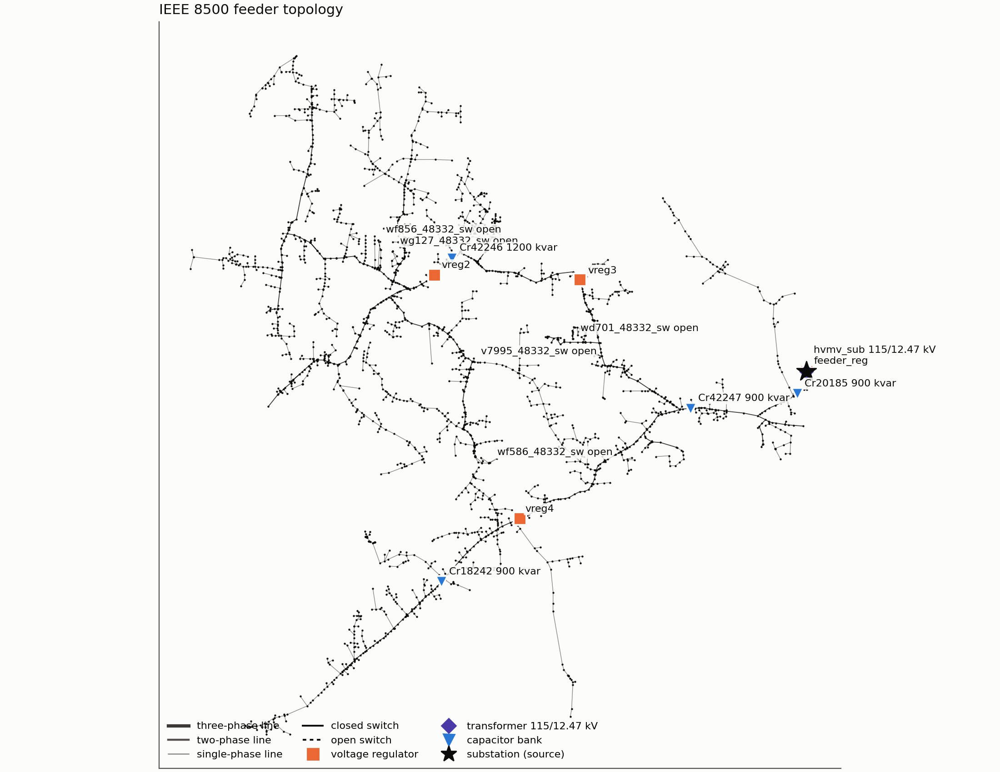

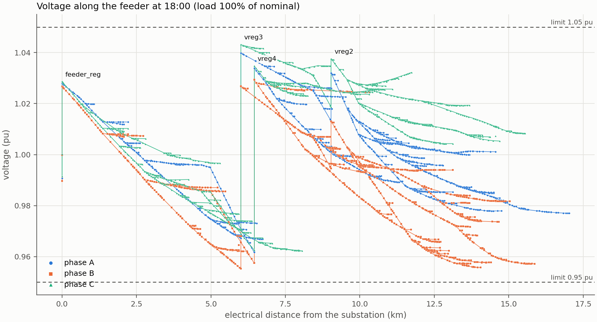

### Estações por frota

| | 1.000 | 1.500 | 2.000 | 2.500 | **3.000** |
|---|---|---|---|---|---|
| Energia pública (MWh/dia) | 9,1 | 13,6 | 18,1 | 22,7 | **27,2** |
| Sessões/dia | 303 | 457 | 608 | 762 | **915** |
| Hubs DC + eletropostos trifásicos + monofásicos | 2 + 0 + 73 | 2 + 8 + 63 | 3 + 9 + 62 | 4 + 6 + 65 | **4 + 9 + 62** |
| Carregadores DC / AC | 6 / 25 | 8 / 32 | 11 / 39 | 13 / 52 | **16 / 59** |
| Potência instalada (kW) | 2.280 | 3.188 | 3.906 | 4.154 | **4.506** |
| CAPEX (milhões de USD, hipótese) | 2,55 | 2,79 | 3,23 | 3,52 | **3,63** |
| Pico das estações: 1 min / 15 min / 1 h (kW) | 1.064 / 955 / 767 | 1.168 / 1.121 / 949 | 1.663 / 1.566 / 1.298 | 2.188 / 1.947 / 1.752 | **2.289 / 2.105 / 1.885** |
| Recargas atendidas | 99 % | 98 % | 98 % | 98 % | **97 %** |
| Cobertura da carga: hubs (1,5 km) / eletropostos (500 m) | 29 % / 100 % | 29 % / 100 % | 38 % / 100 % | 46 % / 100 % | **46 % / 100 %** |

- Os eletropostos cobrem toda a carga em todas as frotas. Por isso o número de locais fica em ~75 e só a composição muda.
- Os hubs vão de 2 a 4, porque os táxis fazem 80 % da recarga em carregador rápido.

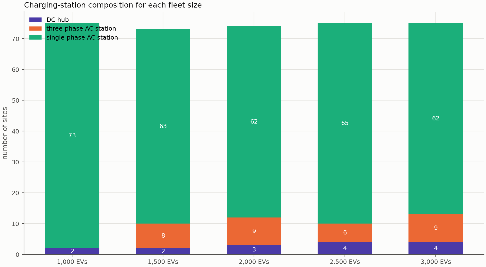

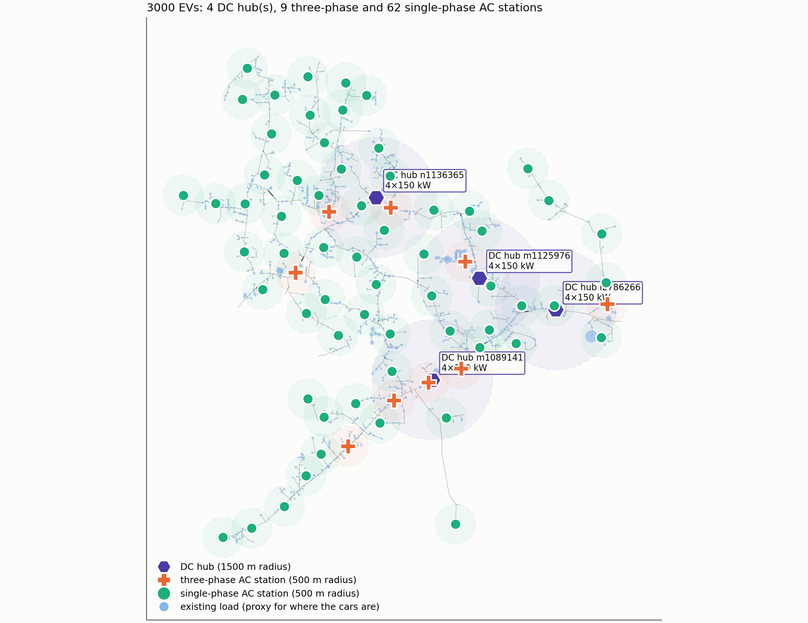

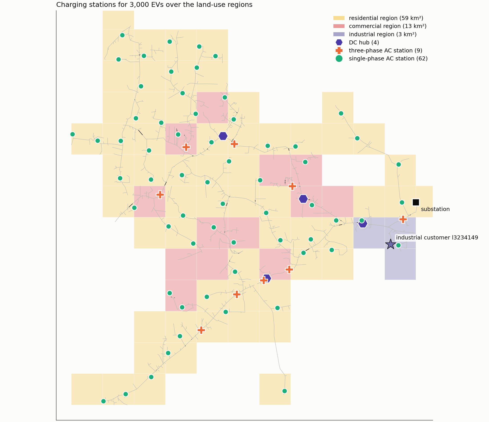

### Sobrecarga conforme a frota

| | S0 | 1.000 | 1.500 | 2.000 | 2.500 | **3.000** |
|---|---|---|---|---|---|---|
| Ponta na subestação | 11.750 kW | +5,6 % | +9,1 % | +12,2 % | +18,0 % | **+18,7 % (13.946 kW)** |
| Linha mais carregada | 96,7 % | 98,9 % | 100,2 % | 103,2 % | 108,4 % | **108,9 %** |
| Tensão mínima, reguladores atuando | 0,951 pu | 0,949 | 0,943 | 0,940 | 0,936 | **0,933 pu** |
| Tensão mínima, taps travados no S0 | 0,951 pu | 0,942 | 0,936 | 0,930 | 0,928 | **0,924 pu** |
| Maior queda causada pelas estações | — | 1,8 % | 2,8 % | 3,1 % | 3,7 % | **4,0 %** |
| Perdas no dia | 14,3 MWh | +8,5 % | +12 % | +18 % | +20 % | **+24 %** |

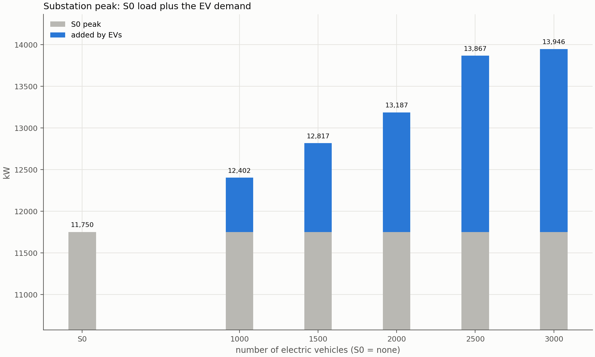

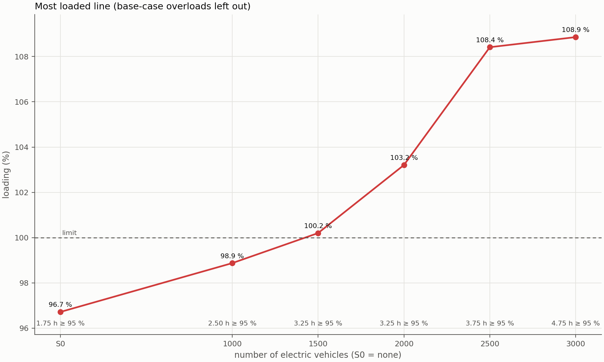

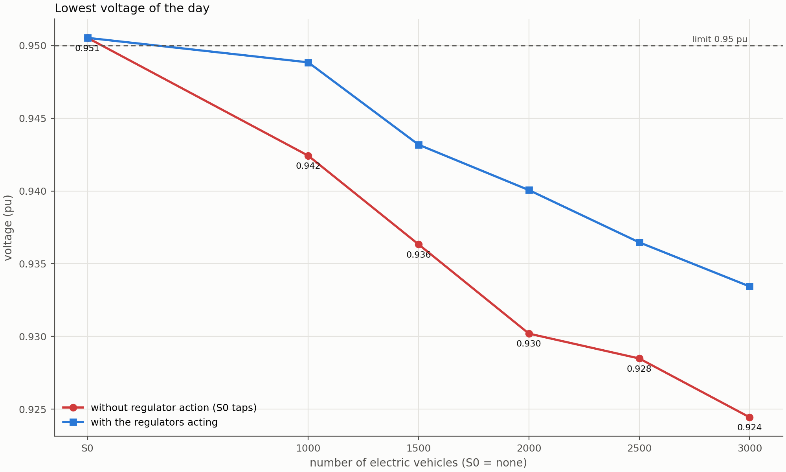

- **A tensão é o primeiro limite.** Com os reguladores atuando, ela já fica abaixo de 0,95 pu com 1.000 veículos.
- **A linha passa de 100 % a partir de 1.500 veículos.** As sobrecargas estão no tronco da saída da subestação (397 ACSR, `ln5513564-1` e vizinhas) e no tronco sul (2/0 ACSR), das 17h às 20h.
- **Os reguladores escondem parte do efeito.** Eles sobem o tap quando as estações puxam a tensão para baixo. Por isso cada S1 é resolvido também com os taps travados nos valores do S0, o que mostra o efeito das estações sozinhas. Bus a bus, a visão regulada mistura a banda morta dos reguladores.

### O dia com 3.000 veículos

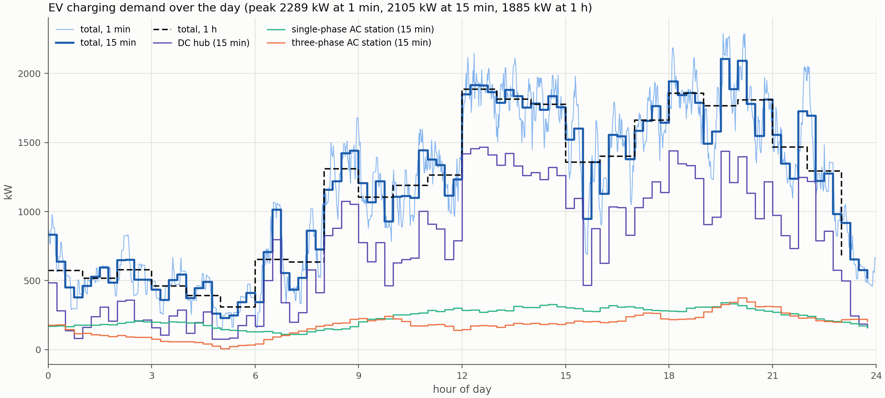

- A demanda das estações tem dois patamares: ~1,9 MW das 12h às 15h (táxis no almoço) e até 2,1 MW das 18h às 21h, quando coincide com a ponta do alimentador.
- Os hubs DC respondem pela maior parte da potência e pelos picos.
- Os eletropostos AC somam ~0,3 MW cada tipo, quase constantes.

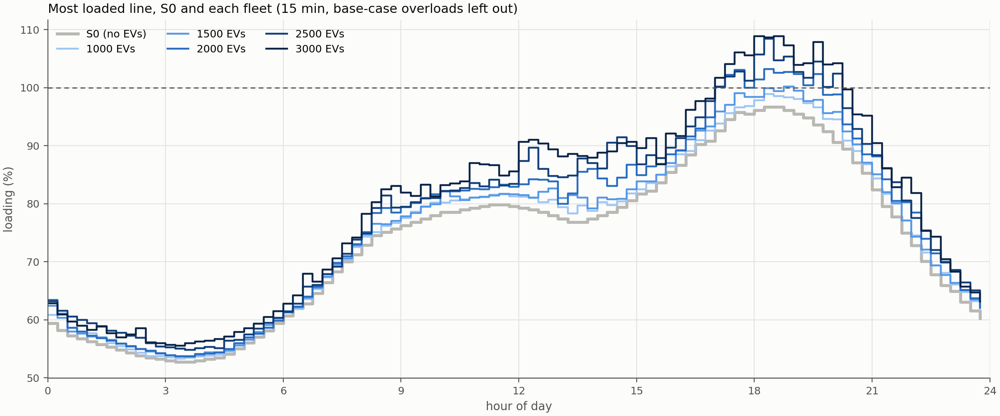

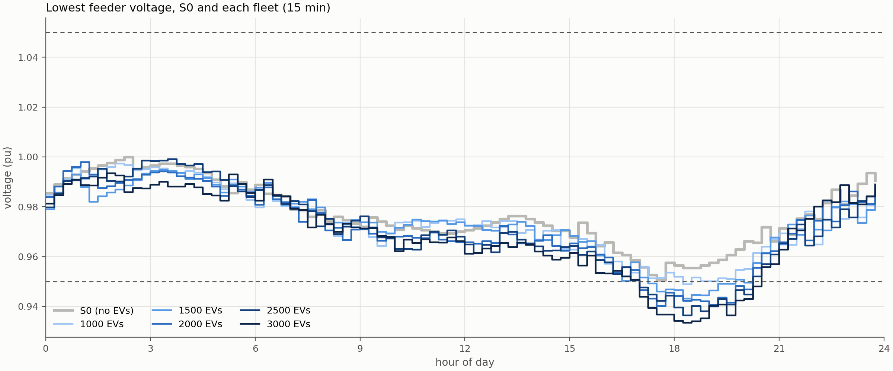

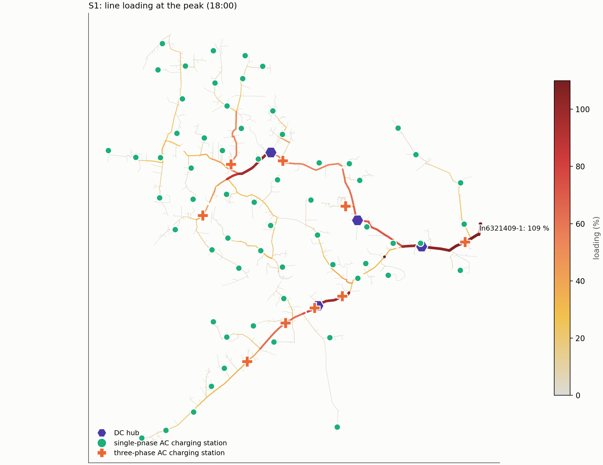

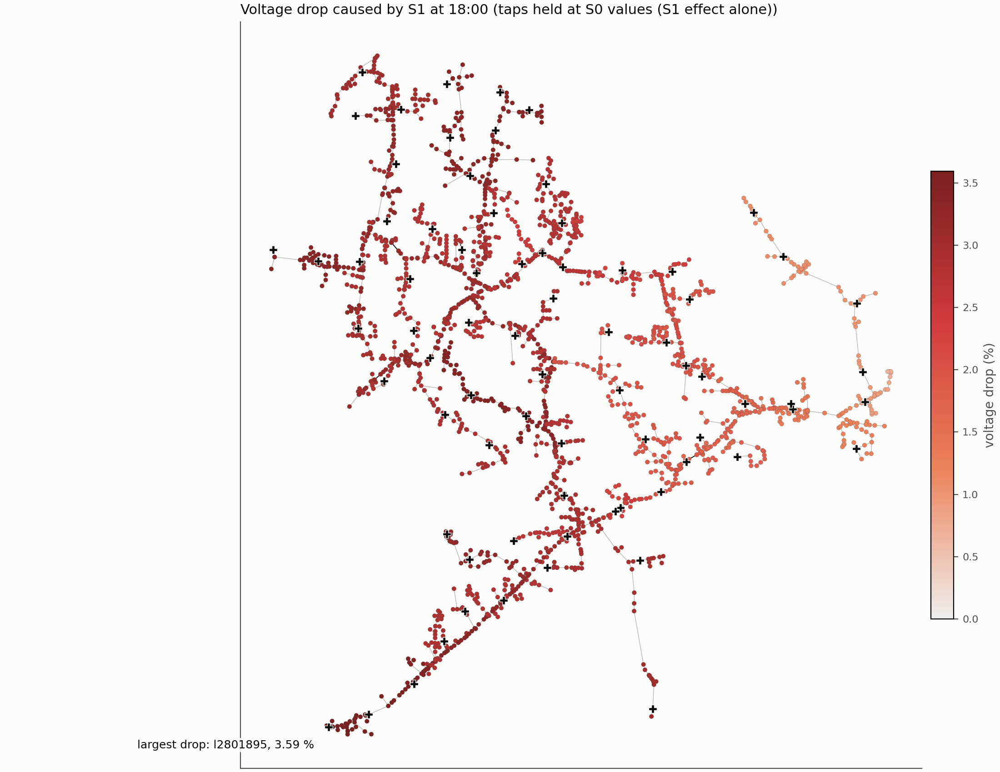

- A queda é maior **longe da subestação, no oeste e no sul**, chegando a ~3,6 % às 18h.
- Perto da subestação a queda fica abaixo de 1,5 %.

### Transformadores de serviço

A redução de média tensão junta cada transformador de serviço com o seu consumidor na barra primária, então o fluxo de potência não enxerga esses transformadores. O carregamento deles é refeito a partir dos resultados salvos (`python -m integration.service_transformers`):

- **Demanda do consumidor:** P e Q nominais × curva diária no passo de 15 min. As cargas do IEEE 8500 são de potência constante, então é a mesma demanda que o fluxo usou.
- **Estação no transformador (hipótese, `service_transformers:` no `evcs.yaml`):** um eletroposto monofásico numa barra de consumidor é atendido pelo transformador desse consumidor, na mesma fase. Eletropostos trifásicos e hubs DC têm transformador próprio, que não existe nos dados do IEEE, e ficam fora.
- **Carregamento:** potência aparente ÷ kVA do transformador (`LoadXfmrs.dss`); carregadores com fator de potência 1.

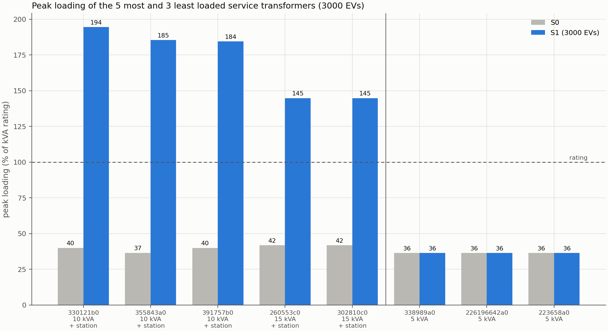

- **No S0 todos ficam entre 36 % e 42 %:** nos dados do IEEE 8500 a carga de cada consumidor é 35–41 % do kVA do seu transformador, e todos seguem a mesma curva diária.
- **Com 3.000 veículos,** 44 transformadores atendem um eletroposto monofásico; **16 passam de 100 %** na ponta e 13 ficam entre 80 % e 100 %.
- **Os piores são de 10 kVA:** chegam a 194 % (`330121b0`, barra `l3142078`) e ficam até 14 h acima de 100 % no dia (`355843a0`). Os 3 menos carregados (5 kVA, sem estação) ficam em 36 %, com curvas idênticas.
- **Por frota** (transformadores acima de 100 %): 10 com 1.000 e 1.500 veículos, 14 com 2.000 e 16 com 2.500 e 3.000.

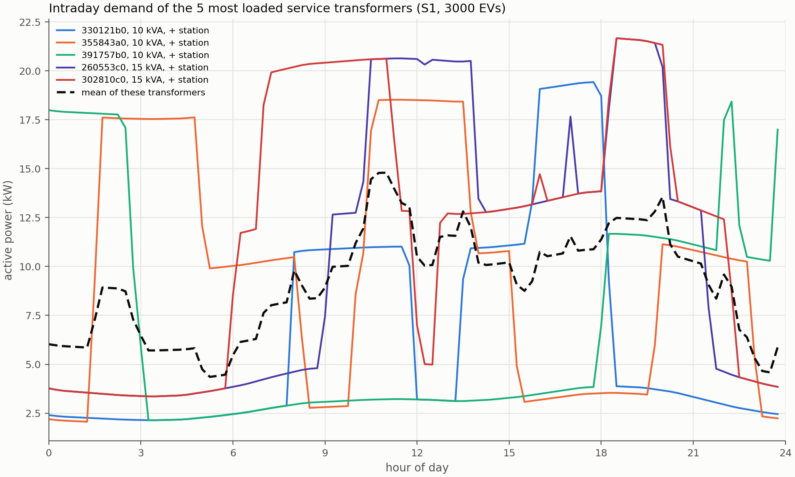

**Cuidados:** o resultado depende da hipótese de o eletroposto usar o transformador do consumidor; com um transformador próprio, essas sobrecargas desaparecem. O valor é a média de 15 min; transformadores aguentam sobrecargas curtas, e a perda de vida (IEEE C57.91) não foi calculada.

### Capacidade da rede

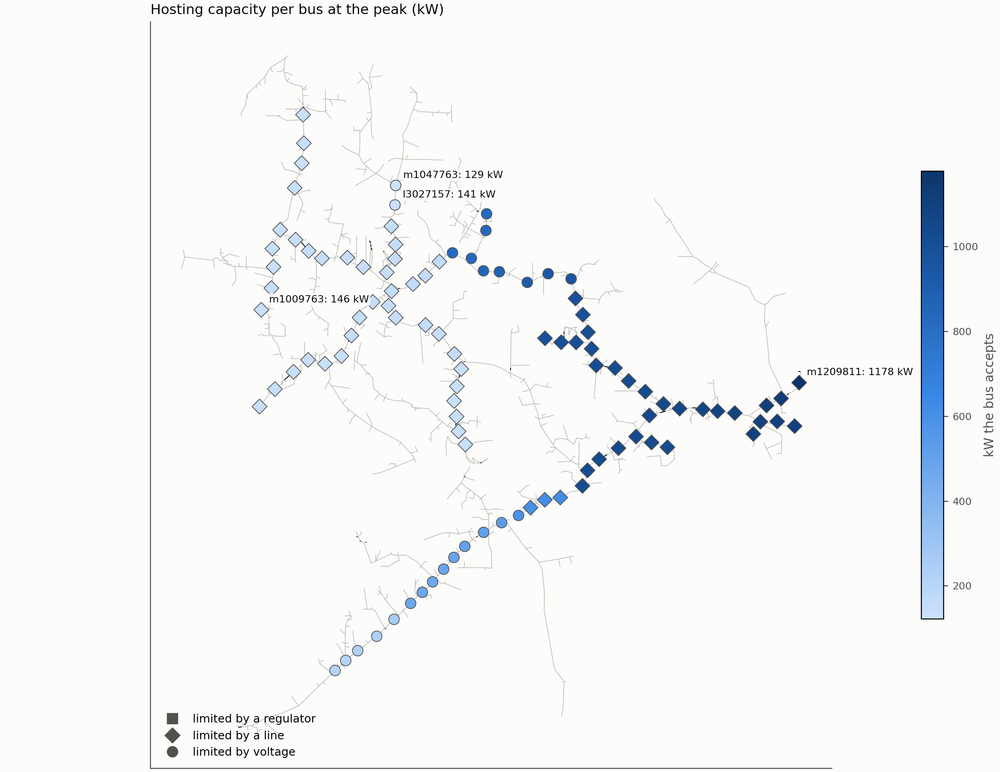

- **Capacidade por barra:** mediana de 475 kW (de 129 a 1.178 kW) nas 101 candidatas.
- **O que limita:**
  - o tronco 2/0 ACSR do sul (`ln5835160-1`) em 42 candidatas;
  - o 397 ACSR da saída (`ln5513564-1`) em 30;
  - a tensão mínima (0,95 pu) em 25.

  Reguladores e subestação não limitam.
- **A rede não aceita a alocação em nenhuma frota** quando todas as estações estão no pico, na ponta: há tensão abaixo de 0,95 pu e linha acima de 100 %. É o que o S1 deve mostrar, para o S2 (BESS) e o S3 (V2G) aliviarem.
- **Recarga em casa** (40 % da energia dos particulares) ainda não entra na rede, porque ocorre na baixa tensão; incluí-la piora todos os cenários.

**Integração S0–S4 (passo de 1 h):** usa as 75 estações de 3.000 veículos (bloco `integration:` do `evcs.yaml`) mais a estação anfitriã do V2G. Ela ainda não foi rodada com a frota mista e será refeita quando BESS e V2G estiverem prontos; ver [`docs/S2_BESS_Kenia.md`](../../docs/S2_BESS_Kenia.md) e [`docs/S3_V2G_Cesar.md`](../../docs/S3_V2G_Cesar.md).

## Tempo de execução

A otimização leva menos de 2 s; o tempo está no fluxo de potência trifásico do IEEE 8500 (2.521 barras): cerca de 3 s por passo de tempo, porque cada passo repete o fluxo ~9 vezes (cargas e capacitores dependentes da tensão, controle dos reguladores).

| Etapa | Tempo hoje |
|---|---|
| Varredura de capacidade da rede (só na 1ª vez; fica salva) | ~1,5 h |
| Triagem com a otimização (5 frotas) | ~9 min |
| S1, 5 frotas × 96 passos × 2 soluções (reguladores atuando e taps travados), em paralelo | ~35–41 min (~65 min em sequência) |
| Integração S0–S4 com `--frozen-taps` | ~15 min |
| Refazer só os gráficos (`python -m integration.redraw`) | ~3 min |
| Análise S0 × S1 com qualidade de energia (`python -m integration.analysis`) | ~15 s |
| Zoneamento residencial / comercial / industrial (`python -m integration.zoning`) | ~10 s |

Testes feitos (Ryzen 5 3600, 6 núcleos, 16 GB): o **numba** acelera só ~6 % (não vale torná-lo obrigatório); o **paralelismo** (um processo por frota, um núcleo por processo: `OMP_NUM_THREADS=1`) roda 5 tarefas em 96 s contra 225 s em sequência, **~2,3× mais rápido**. Depende do número de núcleos do processador, não da placa de vídeo. Implementado (`integration/parallel.py`): o S1 roda uma frota por processo e a varredura de capacidade divide as barras entre os processos; o número de processos é o de núcleos físicos menos um (`--workers` ou a variável `EVCS_WORKERS` mudam isso). Os resultados são idênticos aos da execução em sequência.

## Limitações e próximos passos

- **Análise S0 × S1:** `results/ieee8500/s0_vs_s1/ANALISE.md` compara o caso base e o S1 com indicadores de qualidade de energia (ANSI C84.1 e PRODIST Módulo 8 como referências); harmônicos e flicker não são avaliados.
- **Otimização:** eletropostos por cobertura total de custo mínimo (`optimal_coverage`, HiGHS); os hubs DC ainda são escolhidos de forma gulosa e a rede não entra como restrição da otimização (o impacto é medido no S1, de propósito: o S1 sobrecarrega a rede e o S2 alivia).
- **Um dia representativo só:** a simulação é de um único dia, com uma semente. Para resultados estatísticos, rodar várias sementes (Monte Carlo).
- **Distribuição das sessões:** as sessões são divididas entre as estações ao acaso, não pela distância do carro à estação.
- **Recarga DC simplificada:** a potência é constante até 80 %, sem a redução real perto do fim da recarga.
- **Resolução da integração:** só o estudo S1 do EVCS roda a cada 15 minutos. A integração S0–S4 com BESS e V2G continua horária. Mudar isso envolve os módulos da Kenia e do Cesar e precisa ser combinado com eles.
- **Limite das linhas:** ampacidade por bitola é hipótese de catálogo (ajuste 1); ela define quase toda a capacidade da rede.
- **Candidatas:** a varredura de capacidade usa 101 das 647 barras trifásicas (`candidate_spacing_m`).
